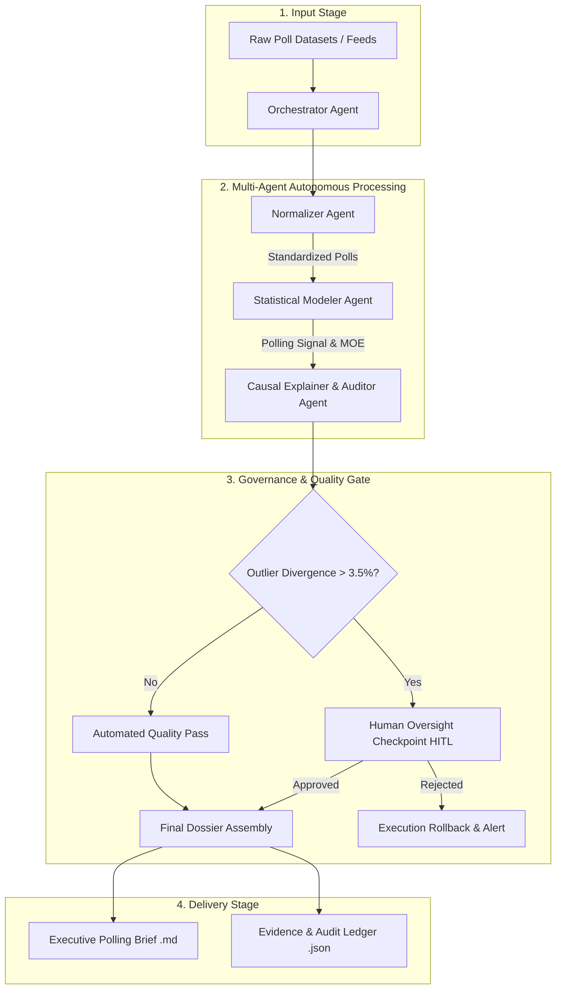
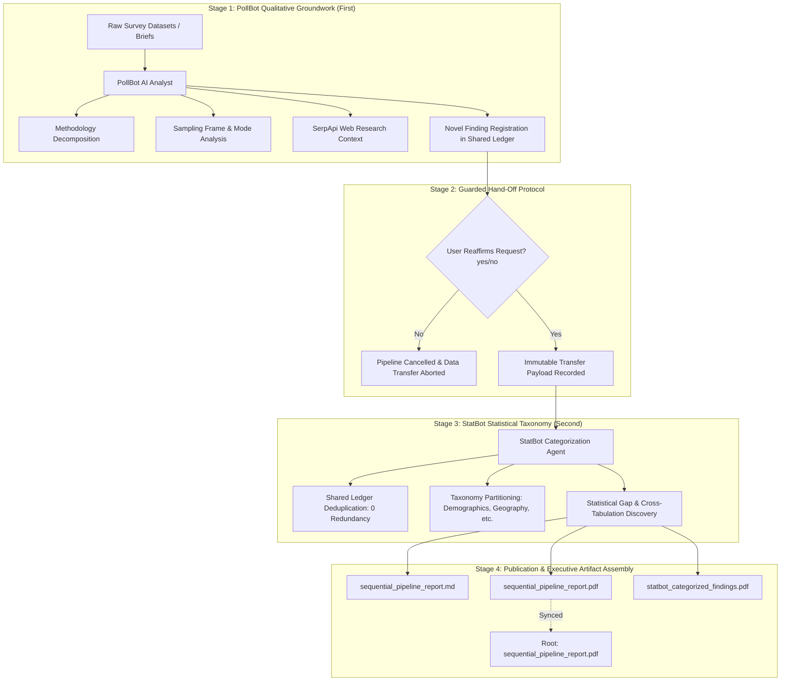

# Polling Error — System Architecture & Multi-Agent Workflow

## Overview
This document specifies the multi-agent architecture and execution lifecycle for the **"Polling Error"** agentic AI program (AI Polling Intelligence Agentic System), designed for Georgian College course **LIAI 1001 – Strategy and Change**. The "Polling Error" program encompasses autonomous worker agents as well as two specialized collaborative agents: **PollBot** (Qualitative Analyst) and **StatBot** (Statistical Taxonomy Specialist).

---

## 1. Multi-Agent Coordination Flow

---

## 2. Component Specifications

### 2.1 Ingestion & Normalizer Agent
- **Voter Screen Weighting:**
  - Likely Voters (LV): Multiplier = $1.00$
  - Registered Voters (RV): Multiplier = $0.85$
  - General Population (Adults): Multiplier = $0.70$
- **Recency Decay Factor:** Exponential time decay based on days elapsed since field completion.

### 2.2 Statistical Modeler Agent
- **Weighted Consensus Calculation:**
  $$Signal_A = \frac{\sum (Share_{A,i} \times Weight_i)}{\sum Weight_i}$$
- **Variance Spread:** Calculates weighted standard error across independent polling houses.

### 2.3 Causal Explanation & Auditor Agent
- Decomposes reported variance into:
  1. Sampling variance (standard margin of error)
  2. Mode effect (Live Caller vs. IVR vs. Online Opt-in)
  3. Turnout model assumptions
- Compiles the audit ledger explaining any outlier divergence.

### 2.4 Human-in-the-Loop (HITL) Checkpoint
- Blocks autonomous dissemination if:
  - Divergence exceeds $\pm 3.5\%$ from consensus.
  - Less than 3 independent pollsters are available in the time window.
- Allows human analyst to inspect raw poll data, enter rationale notes, and approve or reject publication.

---

## 3. PollBot & StatBot Sequential Pipeline Coordination Pattern

The coordination between **PollBot** (Qualitative Analyst) and **StatBot** (Statistical Taxonomy Specialist) implements the **Sequential Pipeline Coordination Pattern**, executing strictly in the established linear sequence:

### 3.1 Sequential Pipeline State Transitions
$$\text{INITIALIZED} \longrightarrow \text{POLLBOT\_STAGE} \longrightarrow \text{HANDOFF\_GATE} \longrightarrow \text{STATBOT\_STAGE} \longrightarrow \text{COMPLETED}$$

1. **Stage 1 (PollBot First):** Ingests raw data or documents, executes qualitative reasoning, and registers verified baseline findings.
2. **Stage 2 (Guarded Checkpoint):** Enforces mandatory human reaffirmation prompt (`yes`/`no`). Halts immediately if declined.
3. **Stage 3 (StatBot Second):** Receives the immutable transfer package, deduplicates using `IntelligenceLedger`, classifies into user-specified taxonomies, and identifies statistical gaps.
4. **Stage 4 (Artifact Assembly):** Emits structured Markdown dossiers and ReportLab executive PDFs synced to the workspace root for one-click downloading.

